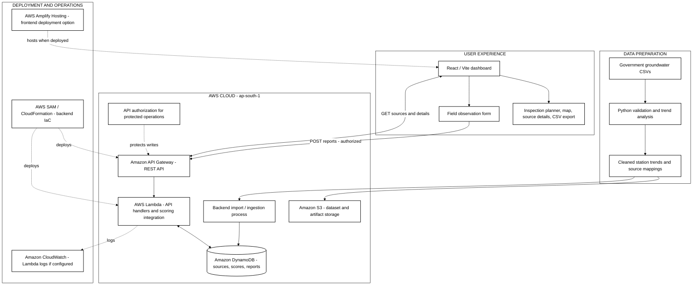

# WellWatch

### From groundwater observations to actionable water-source inspections

**WellWatch** is an AWS-backed decision-support platform for planning inspections of rural water infrastructure in Bihar, India. It combines historical groundwater-monitoring evidence, source-level information, explainable inspection-priority scores, an interactive map, and a capacity-aware weekly inspection planner.

**The question WellWatch answers:** *When field teams cannot inspect every water source, which sources should they examine first, and why?*

> **Demonstration and data-integrity notice:** The current prototype uses **24 synthetic water-source records across 22 Bihar districts**. Their identities and locations are illustrative, **not verified individual handpumps**. Historical groundwater observations originate from government monitoring datasets; derived trends and source-to-station associations remain provisional and require validation. WellWatch does **not** predict pump failures, certify drinking-water safety, or establish a probability that a pump will fail.

---

## 1. The problem

Rural water infrastructure teams must make inspection decisions with limited staff, travel time, and incomplete information. Regional groundwater observations may exist, while individual water-source conditions and community reports are recorded separately or remain unavailable. A map alone does not tell a field officer where to start.

WellWatch addresses this operational gap: it organizes available evidence into **transparent inspection priorities**, lets an officer choose how many sites can be visited, and produces an exportable shortlist for field planning. Its purpose is to **support**, not replace, human judgment.

## 2. What the prototype demonstrates

| Capability | How it helps |
| --- | --- |
| **Inspection-priority dashboard** | Displays source scores, categories, and plain-language reasons returned by the backend. |
| **Weekly inspection planner** | Selects the top *N* scored sources for a chosen inspection capacity, using backend scores rather than recalculating them in the browser. |
| **Export inspection plan** | Downloads a CSV shortlist for field coordination; this is a proposed list, not an assigned or optimized driving route. |
| **Interactive Bihar map** | Displays synthetic source locations and color-coded priorities; selecting a marker opens the relevant source details. |
| **Source evidence and explanations** | Shows available groundwater trends, source-to-station information, and scoring factors, while identifying missing fields. |
| **Water Access Impact** | Separates community-dependence information from technical inspection priority; missing household or alternative-source information is displayed as unavailable. |
| **Search and filtering** | Lets users explore sources by district, source type, priority, and search text where supported by the interface. |
| **Field-observation interface** | Provides a form for reporting source conditions. Successful persistence and score updates depend on backend authorization and must be tested end to end. |

**Example decision:** If a district engineer has capacity for five visits, the planner takes the five highest-scored eligible sources from the API response, displays their reasons, and exports a shortlist. It does not invent field reports, population counts, or new risk scores.

## 3. Data sources and provenance

WellWatch deliberately separates **observed groundwater data** from **synthetic source-level demonstration data**.

| Data layer | Origin | Current interpretation |
| --- | --- | --- |
| Groundwater observations | Government groundwater-monitoring CSV datasets, including CGWB and Bihar monitoring records | Historical observations used as input to preprocessing and trend analysis. |
| Monitoring-station trends | Python cleaning, aggregation, and statistical processing | **388 station trend records** were prepared in the project pipeline. Derived slope/significance results are provisional; measurement-reference conventions need verification. |
| Source-to-station associations | Spatial matching of demonstration source locations to monitoring stations | Contextual regional evidence, **not** a direct water-level measurement at a village handpump. |
| Village water sources | `sources_seed.csv` | **24 synthetic** source identities/locations; useful for testing the workflow, not a verified rural asset registry. |
| Source trend mappings | `source_trends.csv` | **24** synthetic source-to-station mapping records, linked by source ID. |
| Priority scores and explanations | Backend scoring logic, exposed by the REST API | Inspection-priority heuristics, **not** failure probabilities. The available factors depend on the actual backend data. |
| Community impact / field observations | Backend records when supplied | Missing households served, alternative-source information, and report history are not assumed or fabricated. |

### Data processing

1. Obtain and inspect government groundwater CSV exports.
2. Validate records and standardize usable measurements and timestamps.
3. Aggregate observations and compute provisional station-level trends using Python, including Sen's slope and Mann–Kendall significance testing where applicable.
4. Associate demonstration water sources with nearby monitoring-station evidence.
5. Prepare cleaned CSV artifacts for backend ingestion and scoring.
6. Expose source records, scores, and explanations through the AWS API.

**Scientific boundary:** A trend derived from a regional monitoring well does not establish that a nearby village pump is failing. Historical groundwater evidence is one contextual input to inspection planning. No claims of verified groundwater depletion, recovery, or drinking-water safety should be inferred from this demonstration.

---

## 4. AWS system architecture

The application separates the **data preparation and ingestion path** from the **live request and reporting path**. This is important: the Python data-preparation workflow and S3 storage are part of the project, but an automatically triggered S3-to-Lambda ingestion pipeline should be described as operational only after its deployment has been confirmed.

### Black-and-white architecture diagram

*(Standalone Mermaid source: [`WellWatch_AWS_Architecture.mmd`](./WellWatch_AWS_Architecture.mmd))*



**Diagram conventions:** Solid arrows indicate data or request flow. Dashed arrows show supporting infrastructure, optional hosting, security, or observability relationships. The **backend import/ingestion process** is deliberately generic: verify with the backend owner whether it currently runs as an S3-triggered Lambda, a manual import, or another job before changing this diagram to claim automation.

### AWS services and their responsibilities

| AWS service | Role in WellWatch | Evidence to show in a demo |
| --- | --- | --- |
| **Amazon S3** | Stores uploaded groundwater CSVs and/or deployment artifacts. | The project's S3 bucket and its actual objects. |
| **Amazon API Gateway** | Exposes the REST API consumed by the React dashboard. | The deployed `/sources` and `/sources/{source_id}` routes. |
| **AWS Lambda** | Runs API handlers and connects application logic with data and scoring. | Deployed functions, their integrations, and a recent invocation. |
| **Amazon DynamoDB** | Stores backend operational data, including source records and related records as implemented. | Actual table names and a redacted sample item. |
| **AWS SAM / CloudFormation** | Defines and deploys backend resources as infrastructure as code. | The SAM template and deployed CloudFormation stack. |
| **Amazon CloudWatch** | Supports Lambda execution logs and operational debugging when configured. | Logs corresponding to a test API request. |
| **AWS Amplify Hosting** | Can build and host the React frontend from GitHub. | A live Amplify URL **only if deployed**. |
| **Amazon Location Service** | Optional mapping integration; the interface can also use an OpenStreetMap basemap. | Map configuration, if the AWS mapping integration is enabled. |

### Live request flow

1. The browser requests `GET /sources` from **API Gateway**.
2. API Gateway forwards the request to the configured **Lambda** handler.
3. The handler retrieves available source records, associated evidence, and priority information from **DynamoDB** or the configured backend data layer.
4. The API returns source data, including available priority scores, levels, reasons, and factors.
5. The React frontend normalizes the response and renders the dashboard, source details, and map.
6. The **inspection planner runs in the browser**: it sorts eligible backend scores and selects the top *N* sources. **CSV export also runs in the browser.** These two features do not invoke a separate AWS planning service.

### Field-report flow

1. A user completes the field-observation form.
2. The frontend sends an authorized `POST /reports` request through API Gateway.
3. Backend validation and authorization determine whether the report can be accepted.
4. Persistence and priority recalculation should be presented as **verified live behavior only after a successful authenticated submission and follow-up score check**.

This distinction matters: the presence of a report form or API route alone does not prove that a submitted report changed the score.

## 5. API contract

**AWS region:** `ap-south-1` (Mumbai)  
**API base URL:** `https://e95a0mqwd6.execute-api.ap-south-1.amazonaws.com/Prod/`

| Method | Route | Purpose |
| --- | --- | --- |
| `GET` | `/sources` | Retrieve source collection and associated priority data. |
| `GET` | `/sources/{source_id}` | Retrieve details for a single source. |
| `POST` | `/reports` | Submit a source-related observation, subject to authorization. |

The source-list response is structured around a `count` and `sources` array. A source may contain fields such as `source_id`, `village`, `district`, coordinates, `synthetic`, groundwater-mapping fields, and a nested `priority` object with `score`, `level`, `reasons`, `factors`, and `data_completeness`. Optional and absent fields must be handled safely.

**Authentication:** The API has used Bearer-token authorization. CORS and authentication are separate: a browser receiving a readable `401 Unauthorized` response is not evidence of a CORS failure. Do not publish shared tokens or put them in `VITE_` variables. Confirm the current authorization policy for each route before a public demo.

## 6. Technology stack

| Layer | Technology |
| --- | --- |
| Frontend | React, Vite, JavaScript |
| Maps | MapLibre; OpenStreetMap basemap; optional Amazon Location Service |
| API | Amazon API Gateway, AWS Lambda |
| Operational storage | Amazon DynamoDB |
| Dataset / artifact storage | Amazon S3 |
| Data processing | Python, CSV-based validation and statistical trend analysis |
| Deployment | AWS SAM / CloudFormation for backend; AWS Amplify Hosting supported for frontend |
| Version control | Git, GitHub |

## 7. Run locally

### Prerequisites

- Node.js 18 or newer
- npm
- Git

```bash
git clone https://github.com/ddakshatha18-spec/Well-Watch.git
cd Well-Watch/frontend
npm install
npm run dev
```

Open the local address printed by Vite, commonly `http://localhost:5173`.

If the repository includes `frontend/.env.example`, copy it to `.env.local` and adjust only the configuration values needed for your environment. Never commit secrets.

### Frontend environment variables

| Variable | Purpose |
| --- | --- |
| `VITE_API_BASE_URL` | Backend API base URL. |
| `VITE_API_PROXY_TARGET` | Development proxy target, if used. |
| `VITE_LOCATION_API_KEY` | Optional browser-usable mapping key, subject to appropriate restrictions. |
| `VITE_LOCATION_REGION` | AWS region for the optional mapping integration. |

**Security note:** `VITE_` values are exposed to the browser bundle. Never put Bearer secrets, AWS credentials, or private API keys there.

### Tests and production build

Run from `frontend/`:

```bash
npm test
npm run build
```

The production frontend output is generated in `frontend/dist/`. Automated tests do not replace end-to-end checks against the deployed AWS API.

## 8. Deployment

### Backend

The backend uses AWS serverless resources and is described as managed through AWS SAM / CloudFormation. Use the backend repository's actual SAM template and deployment procedure for infrastructure changes; this frontend README does not assume a particular stack name or deploy command.

### Frontend

1. Push reviewed frontend changes to GitHub.
2. In AWS Amplify, connect the repository and intended branch.
3. Verify the build settings in `amplify.yml` and the `frontend/` application root.
4. Set the necessary **public** frontend configuration variables.
5. Deploy, then verify API requests, source selection, map rendering, and CSV export from the hosted URL.
6. Test authorized report submission separately, if enabled for the demo.

Deploying the frontend does not redeploy the backend.

## 9. Repository layout

The following reflects the documented project organization; verify paths against the current GitHub branch before treating them as authoritative.

```text
Well-Watch/
├── README.md
├── amplify.yml
├── frontend/
│   ├── src/
│   │   ├── api/          # API requests and error handling
│   │   ├── lib/          # Normalization and validation
│   │   ├── hooks/        # Source and detail data hooks
│   │   ├── components/   # Dashboard and map components
│   │   └── test/         # Automated tests
│   ├── .env.example
│   └── package.json
├── docs/
│   ├── REQUIREMENTS.md
│   └── DEMO_SCRIPT.md
└── data/
    ├── sources_seed.csv
    └── source_trends.csv
```

## 10. Responsible use and current limitations

- **Synthetic asset registry:** The 24 sample sources are not a verified Bihar water-infrastructure inventory. Display names such as *Sample Source 21* are presentation labels, not confirmed village names.
- **Provisional groundwater interpretation:** Station trend estimates need verification of measurement conventions, coverage, and statistical assumptions before operational use.
- **Regional versus local evidence:** A nearby monitoring-station trend is not a direct measurement of a handpump's condition.
- **No failure prediction:** Scores indicate relative inspection priority under the current heuristic; they are not probabilities of pump breakdown.
- **Incomplete community impact:** Household counts, alternative water availability, and some field observations may be missing. Missing values are **unknown**, not zero.
- **Not a route optimizer:** The planner selects top-ranked sources based on capacity; it does not calculate road travel times, assign staff, or optimize vehicle routes.
- **No proven real-world outcomes yet:** Reduced outages, improved water access, and lower travel costs are intended impacts, not measured results from this prototype.
- **Operational readiness:** Real deployment requires verified source registries, field validation, secure authentication, access controls, monitoring, and an agreed inspection workflow.

## 11. Three-minute demonstration path

| Time | Screen | What to demonstrate |
| --- | --- | --- |
| `0:00–0:25` | Inspection Dashboard | The resource-allocation problem and the current sample-source overview. |
| `0:25–1:00` | Data & Methodology | Government data processing, 388 provisional station trends, and 24 synthetic source mappings. |
| `1:00–1:45` | AWS architecture diagram | S3 for data/artifacts; API Gateway and Lambda for requests; DynamoDB for records; SAM for deployment. Clearly distinguish optional or unverified integrations. |
| `1:45–2:20` | Inspection Planner and source details | Change inspection capacity, show backend scores and reasons, export CSV. |
| `2:20–2:45` | Map and field observation form | Show spatial exploration and the reporting workflow; submit only if the authenticated end-to-end path is confirmed. |
| `2:45–3:00` | Dashboard | Explain the impact: helping teams decide where to inspect first. |

### Suggested judge-facing explanation

> “WellWatch connects historical government groundwater observations to an AWS-backed source-prioritization API. Our Python pipeline prepares provisional station trends, while the deployed backend provides source records and explainable inspection scores through API Gateway and Lambda. The React dashboard turns those scores into a capacity-aware inspection plan that can be exported for field use. The 24 individual water sources are transparently synthetic demonstration records; our goal is to validate this workflow with verified source and community data.”

## 12. Future work

- Integrate verified handpump and borewell inventories with validated geocoordinates.
- Add confirmed community-impact surveys, including households served and alternative water availability.
- Complete and validate authorized field-report persistence and score-refresh behavior.
- Introduce officer assignment, inspection outcomes, and a documented resolution workflow.
- Add road-network routing and offline-friendly field workflows where justified by user testing.
- Evaluate scoring quality and operational value against real inspection outcomes before scaling.

---

**WellWatch is a decision-support prototype: government groundwater evidence in, explainable inspection priorities out, and a practical plan for what to inspect next.**
